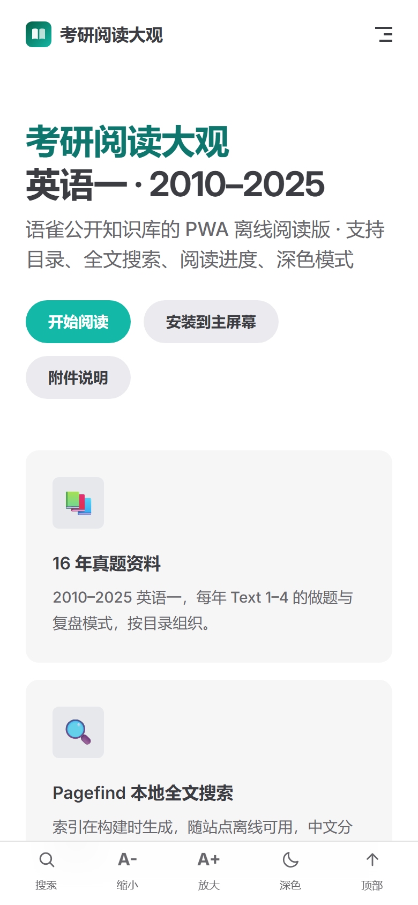
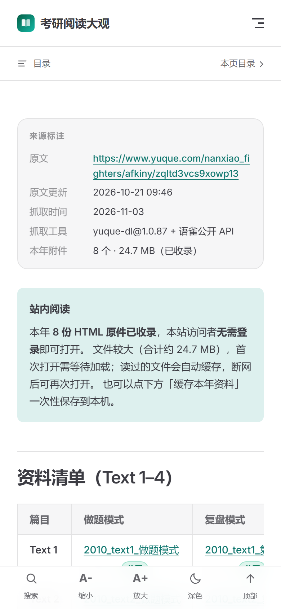
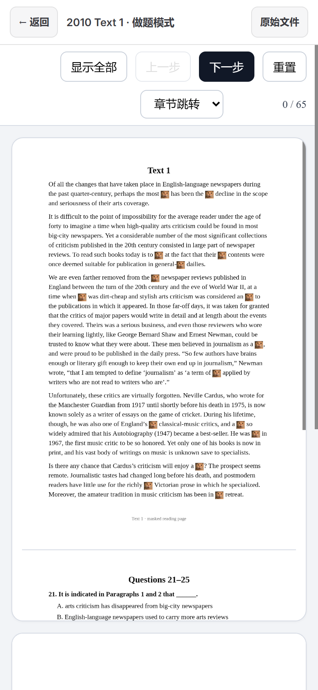

# 考研阅读大观 · 英语一 PWA 离线阅读

把语雀公开知识库 [《考研阅读大观》](https://www.yuque.com/nanxiao_fighters/afkiny) 的**英语一**部分，做成可安装到安卓主屏幕、断网可读的静态 PWA。

> **在线地址（已部署）**：<https://codlaodi.github.io/kaoyan-reading-pwa/>
> 仓库：<https://github.com/codlaodi/kaoyan-reading-pwa>
> 手机 Chrome 打开 → ⋮ → **添加到主屏幕**，首次停留几秒等预缓存完成。

- 范围：**英语一 2010–2025**，17 篇文档（1 个分区页 + 16 个年份页）；**英语二未收录**。
- 内容：目录、标题、资料清单、来源标注、yuque-dl 抓取的原文 Markdown。
- 附件：**128 个 HTML 原件已全部收录**（约 393 MB），站内阅读器**免登录**打开；读过的自动缓存，年份页可整年下载。原件未做任何改写。详见 [附件清单](docs/ATTACHMENTS.md) 与 [版权说明](#数据来源与边界)。

| 首页（移动端） | 年份页（离线） | 站内阅读器 |
| --- | --- | --- |
|  |  |  |

## 功能

| 功能 | 实现 |
| --- | --- |
| 目录导航 | VitePress 侧边栏 + 首页 16 个年份卡片 + 移动端抽屉 |
| 站内资料阅读 | 128 份 HTML 原件托管，`/reader.html` 全屏 iframe 打开，顶部返回/原始文件 |
| 全文搜索 | Pagefind 1.6 本地索引（中文分词），自绘搜索弹窗，`Ctrl/⌘+K` 或 `/` 唤起 |
| 阅读进度 | 顶部进度条、按页记录百分比、首页「继续上次阅读」、页内续读提示 |
| 深色模式 | VitePress 主题 + 移动端工具条一键切换，偏好本地保存 |
| 字号调节 | A- / A+ 五档（90%–130%），仅作用于正文，localStorage 记忆 |
| 离线阅读 | 外壳预缓存 136 个文件（2.4 MB）；附件按需缓存 + 年份页「缓存本年资料」 |
| PWA 安装 | manifest（192/512/maskable）+ Service Worker + 独立窗口启动 |
| 无账号 / 无追踪 | 访客不需要语雀账号；无本站账号、无统计、无第三方脚本 |

## 快速开始

要求 **Node.js ≥ 18.18**、**pnpm ≥ 10**（开发时使用 Node 24 / pnpm 11）。

```bash
pnpm install

# 1) 元数据（匿名公开接口）
pnpm fetch

# 2) 128 个附件原件（需要你本人在弹窗浏览器里登录一次语雀）
#    先启动带调试端口的 Chrome，登录后运行：
pnpm fetch:attachments

pnpm dev        # 本地开发 http://localhost:5173（dev 不含附件原件）
pnpm build      # 内容 → VitePress → Pagefind → 复制附件 → Service Worker → 自检
pnpm preview    # 预览构建产物 http://127.0.0.1:4173
pnpm verify     # 无头 Chrome 断网验收（需要本机 Chrome 或 Edge）
```

Windows PowerShell 指定部署子路径：

```powershell
$env:BASE_PATH="/<仓库名>/"; pnpm build
```

### 常用脚本

| 命令 | 作用 |
| --- | --- |
| `pnpm fetch` | 用语雀公开接口重新抓取元数据 → `raw/manifest.json`（不登录） |
| `pnpm fetch:attachments` | 用本机登录会话下载 128 个附件 → `raw/attachments/`（不读取密码） |
| `pnpm content` | 由 `raw/` 生成 `content/` Markdown 与 `raw/attachments.csv` |
| `pnpm build` | 全量构建 + 复制附件 + 产物自检（需要 `raw/attachments`） |
| `pnpm dev` | VitePress 开发服务器（附件原件不参与 dev） |
| `pnpm preview` | 本地静态预览（支持 `BASE_PATH`） |
| `pnpm verify` | 自动离线验收，输出 `artifacts/` 报告与截图 |
| `pnpm deploy:gh` | 通过 GitHub API 发布 main + gh-pages（需 `GH_TOKEN`） |
| `pnpm icons` | 用 Pillow 重新生成 PWA 图标（需 Python + Pillow） |

## 目录结构

```text
yuque-pwa/
├─ content/                     # VitePress 内容源（由 raw/ 生成，可重新生成）
│  ├─ index.md                  # 首页（hero + 继续阅读 + 范围说明）
│  ├─ english-1/
│  │  ├─ index.md               # 分区总览 + 年份卡片
│  │  └─ 2010.md … 2025.md      # 16 个年份页（来源栏 / 资料表 / 原文折叠区）
│  ├─ guide.md / about.md / attachments.md / offline.md / reader.md
│  └─ public/                   # 原样拷贝到站点根：manifest、图标、logo、favicon、robots.txt
├─ raw/                         # 抓取原料（可追溯，构建只读）
│  ├─ manifest.json             # 17 篇文档 + 128 个附件元数据 + 访问性抽查
│  ├─ attachments.csv           # 附件清单（Excel 可读）
│  ├─ attachments/              # 128 个 HTML 原件（393 MB，gitignored）
│  ├─ README.md                 # 抓取方式与来源说明
│  └─ yuque-dl/                 # yuque-dl 下载的原文 Markdown（仅英语一）
├─ scripts/
│  ├─ fetch-yuque.mjs           # 公开接口抓元数据（不登录）
│  ├─ fetch-attachments.mjs     # 用本机登录会话下载 128 个附件（不读密码）
│  ├─ build-content.mjs         # raw → content 的确定性生成
│  ├─ build.mjs                 # 构建总入口（6 步 + 自检）
│  ├─ serve-dist.mjs            # 本地静态服务器（支持 BASE_PATH）
│  ├─ verify-offline.mjs        # Chrome CDP 断网验收（24 项）
│  ├─ gh-deploy.mjs             # GitHub API 发布（无需本机 git）
│  └─ make-icons.py             # PWA 图标生成
├─ pwa/sw.js                    # 自定义 Service Worker（esbuild 打包）
├─ .vitepress/
│  ├─ config.mts                # 站点、侧边栏、head、标题模板
│  └─ theme/                    # 自定义 Layout、阅读器、搜索、字号、进度、样式
├─ docs/                        # 部署 / PWA / 验收 / 附件说明
├─ artifacts/                   # 验收截图与 JSON 报告
├─ .github/workflows/deploy.yml # 可选：Actions 自动部署（当前未启用）
├─ vercel.json                  # Vercel 部署配置
└─ LICENSE                      # 代码 MIT；内容版权归原作者
```

## 构建产物说明

`pnpm build` 输出到 `.vitepress/dist/`（当前约 **396 MB**，其中附件 393 MB；预缓存 136 个外壳文件 / 2.4 MB）：

| 产物 | 说明 |
| --- | --- |
| `index.html`、`english-1/*.html`、`guide.html`、`about.html`、`attachments.html`、`reader.html`、`offline.html`、`404.html` | 24 个站点页面 |
| `attachments/<年份>/*.html` | 128 个资料原件（按年份，原文件名），不预缓存、按需缓存 |
| `assets/` | VitePress 客户端 JS/CSS 与 Inter 字体（woff2，含多语言子集） |
| `pagefind/` | 中文搜索索引：`pagefind.js`、worker、wasm、`pagefind-entry.json`、22 个分片 |
| `manifest.webmanifest`、`icons/`、`logo.svg`、`favicon.svg` | PWA 元数据与图标 |
| `sw.js` | Workbox Service Worker（约 37 KB，已内联预缓存清单） |
| `.nojekyll` | 关闭 GitHub Pages 的 Jekyll 处理 |

产物自检会验证：manifest、图标、`sw.js`、Pagefind、关键页面、`reader.html`、附件样本，且 **SW 不得预缓存 attachments**。

## PWA 配置

- **Manifest**：相对路径 `start_url`/`scope`/图标，同一份产物可部署在根路径或任意子路径。
- **预缓存**：外壳 136 个文件（HTML/JS/CSS/字体/图标/Pagefind 索引）；`attachments/**` 明确排除，避免安装时占 393 MB。
- **附件缓存**：`/attachments/` 走运行时 `CacheFirst`（最多 200 个、一年）；阅读器用 iframe 打开，导航回退路由必须 `denylist` 掉 `/attachments/`，否则会被当成页面导航。
- **离线搜索关键点**：Pagefind 会给 `pagefind-entry.json` 附加 `?ts=`，SW 的 `ignoreURLParametersMatching` 必须忽略 `ts`。
- **导航回退**：未缓存页面返回独立兜底页（避免被 VitePress 路由渲染成 404）。
- **更新**：新 SW 等待 → 页面提示「站点有新版本」→ `SKIP_WAITING` → 自动刷新。

完整说明见 [docs/PWA.md](docs/PWA.md)。

## 部署（已上线）

**当前状态**

| 项 | 值 |
| --- | --- |
| 线上地址 | <https://codlaodi.github.io/kaoyan-reading-pwa/> |
| 仓库 | <https://github.com/codlaodi/kaoyan-reading-pwa> |
| 托管 | GitHub Pages（项目站点，`base = /kaoyan-reading-pwa/`） |
| Pages 源 | `gh-pages` 分支（已构建的 `dist` 内容） |
| 部署方式 | `scripts/gh-deploy.mjs` 通过 GitHub REST API 上传；**本机不需要 git** |

**更新线上内容**

```bash
# 1) 重新构建（必须与仓库名一致的 base；会复制 393 MB 附件）
BASE_PATH=/kaoyan-reading-pwa/ pnpm build

# 2) 用具备 repo 权限的 token 推送 main + gh-pages
GH_TOKEN=ghp_xxx node scripts/gh-deploy.mjs

# 只更新源码 main、不动 gh-pages：
GH_MAIN_ONLY=1 GH_TOKEN=ghp_xxx node scripts/gh-deploy.mjs
```

> 完整站点约 **396 MB**，首次上传/更新 gh-pages 需十几分钟（Blob API 并发上传 + Pages 重建）。
> `raw/attachments/` 与 `dist/` 都在 `.gitignore` 中，源码仓库只保留脚本与文档。

**其他部署方式**

- **GitHub Actions**：`.github/workflows/deploy.yml` 已备好，推送 `main` 即自动构建发布；但当前授权 token 不含 `workflow` scope，因此仓库暂未包含 `.github`、Pages 仍用 `gh-pages` 分支。给 token 加 `workflow` 权限后上传该目录，并把 Pages Source 切到 **GitHub Actions** 即可。注意 Actions 里没有 393 MB 附件，需要额外存储/下载步骤。
- **Vercel**：`vercel.json` 已配置；但 Vercel 免费部署有体积限制，396 MB 站点可能超限，优先用 GitHub Pages。

逐步操作、base 说明与常见问题见 [docs/DEPLOY.md](docs/DEPLOY.md)。

## 验收

自动化验收 **24/24 通过**，覆盖：manifest、Chrome 可安装、SW 激活与接管、136 项外壳预缓存、断网打开首页/年份页/附件清单、**站内免登录打开附件**、附件写入离线缓存、**断网重开附件**、整年缓存按钮、中文与数字搜索、字号、深色、阅读进度、继续阅读、未缓存页回退。

- **本地根路径**：24/24（`artifacts/verify-offline-local.json`）。
- **子路径构建**：`BASE_PATH=/kaoyan-reading-pwa/` 下 24/24（`artifacts/verify-offline-base.json`）。
- **线上复测**：直接对 <https://codlaodi.github.io/kaoyan-reading-pwa/> 跑同一套脚本，**24/24**（`artifacts/verify-offline-live.json`）。
- 验收方法：`pnpm build` 后 `pnpm verify`；脚本会**先停掉本地服务器**再断网，避免“其实还在访问 localhost”的假通过。
- 安卓手动清单见 [docs/ACCEPTANCE.md](docs/ACCEPTANCE.md)。

## 数据来源与边界

| 项目 | 说明 |
| --- | --- |
| 来源 | 语雀公开知识库《考研阅读大观》，`https://www.yuque.com/nanxiao_fighters/afkiny` |
| 元数据 | 匿名公开页面 + 公开 JSON 接口；正文 Markdown 由 yuque-dl 1.0.87 生成 |
| 附件 | 128 个 HTML，约 393.4 MB；由维护者**本人在语雀登录后**下载，密码未离开浏览器、未保存；站点访客无需登录 |
| 范围 | 仅“阅读英语一10-25”分区；英二未收录 |
| 版权 | 原文/真题/解析版权归原作者及权利人；原件未改写，已设置 `noindex`；请勿公开传播 |
| 隐私 | 访客无账号、无后端、无统计；进度/字号/主题仅存 `localStorage` |

初始探测的完整记录（链接状态、34 篇目录、正文形态、附件登录墙、匿名导出尝试）见 [docs/SURVEY.md](docs/SURVEY.md)。

## 已知限制

- 128 份附件总体积 393 MB，不随壳层预缓存；未读过的附件需联网，读过后可离线，整年缓存约 24 MB/年。
- Pagefind 只索引站点页面与资料标题，不索引 393 MB 附件内部全文。
- 站点是公开 URL（GitHub Pages 免费版），虽已 `noindex`，拿到链接的人仍可访问；不适合私密分发。
- 阅读进度不跨设备同步，清除站点数据会丢失。
- 首次全量部署/更新 gh-pages 耗时较长（约十几分钟）。

## License

代码与构建脚本：[MIT](LICENSE)。`raw/` 与 `content/english-1/` 中的文档内容版权归原作者，不在 MIT 授权范围内。