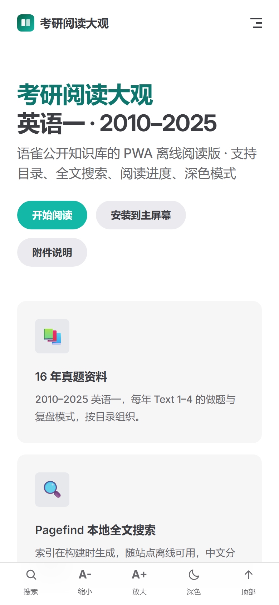
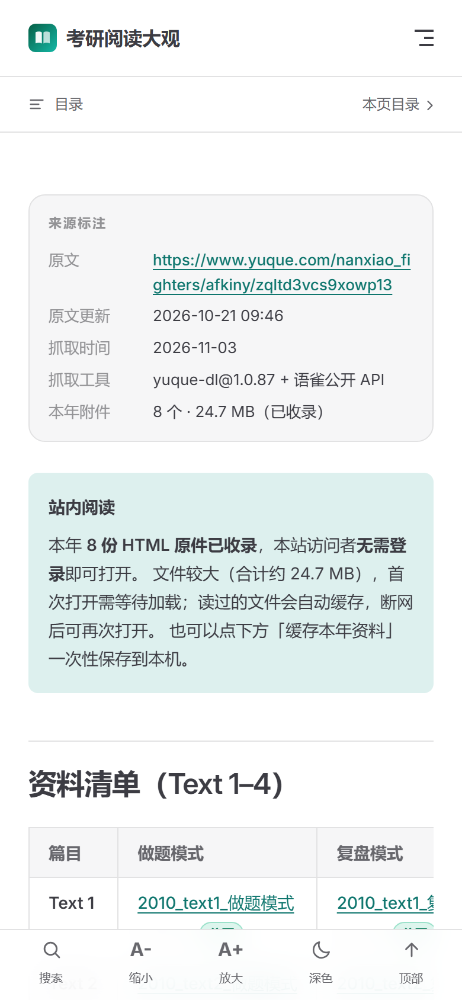

# 验收报告与清单

## 一、自动化验收（19/19 通过）

**线上环境**：<https://codlaodi.github.io/kaoyan-reading-pwa/>（2026-11-03 复测，19/19）
**本地根路径**：`BASE_PATH=/`（19/19）
**子路径构建**：`BASE_PATH=/kaoyan-pwa/`（19/19）

运行方式：

```bash
pnpm build
pnpm verify                              # 本地：会真正停掉服务器再断网
VERIFY_URL=https://<站点>/ BASE_PATH=/<base>/ pnpm verify   # 线上：DevTools 断网模拟
```

脚本用本机 **Chrome 156 无头模式 + CDP** 驱动，关键动作：

1. 加载站点，等待 Service Worker **激活并接管**，再等待 Cache Storage 达到 **131 项**（线上慢网络下必须显式等待，否则会误判）；
2. 本地模式：**停止本地服务器**（不是只勾 DevTools Offline，避免“其实还在访问 localhost”的假通过）；
   线上模式：使用 DevTools 离线模拟（无法关闭远端服务器）；
3. 逐页导航、搜索、交互并断言；
4. 截图与 JSON 存档到 `artifacts/`：
   - `verify-offline-live.json`（线上）
   - `verify-offline-local.json`（本地）
   - `verify-offline-base.json`（子路径）

| # | 检查项 | 结果 | 说明 |
| --- | --- | --- | --- |
| 1 | PWA manifest 可解析 | ✅ | `manifest.webmanifest` 无错误（线上 MIME 为 `application/manifest+json`） |
| 2 | Chrome 可安装性检查 | ✅ | `Page.getInstallabilityErrors` 无错误 |
| 3 | Service Worker 激活 | ✅ | `activated` |
| 4 | Service Worker 接管页面 | ✅ | `navigator.serviceWorker.controller` 非空 |
| 5 | 预缓存写入 Cache Storage | ✅ | 131 个请求 / 约 2.4 MB |
| 6 | 首页渲染 | ✅ | 标题、CTA 正常 |
| 7 | 移动端底部工具条 | ✅ | 搜索 / 字号 / 主题 / 顶部 |
| 8 | 进入离线状态 | ✅ | `navigator.onLine === false`（本地模式同时已停服务器） |
| 9 | 断网打开年份页 | ✅ | `/english-1/2010.html` 标题与正文正确 |
| 10 | 附件链接保留原始来源 | ✅ | 指向 `www.yuque.com/attachments/...` |
| 11 | 字号调节 A+ | ✅ | 正文 16px → 17.6px |
| 12 | 深色模式切换 | ✅ | `<html class="dark">` 切换 |
| 13 | 阅读进度写入 localStorage | ✅ | 滚动后产生进度条目 |
| 14 | 断网打开附件清单 | ✅ | 128 条记录 + 表头 = 131 行 |
| 15 | 断网 Pagefind 中文搜索「复盘」 | ✅ | 命中 21 条（中文分词有效） |
| 16 | 断网 Pagefind 数字搜索「2010」 | ✅ | 命中 6 条 |
| 17 | 搜索弹窗 Ctrl+K | ✅ | 遮罩与输入框出现 |
| 18 | 首页「继续上次阅读」 | ✅ | 显示标题、进度与入口 |
| 19 | 未缓存页面回退 | ✅ | 独立离线兜底页，不渲染成 404 |

原始结果：`artifacts/verify-offline.json`（含每条断言的时间与详情）。

同时用 `BASE_PATH=/kaoyan-pwa/` 重新构建并完整跑了一遍同样的 19 项，**全部通过**，证明 GitHub Pages 子路径部署可用。

### 截图

| 首页（移动端） | 年份页（断网） |
| --- | --- |
|  |  |

---

## 二、安卓手机手动验收清单

> 需要先部署到 HTTPS 地址（GitHub Pages / Vercel），本地 `localhost` 只能用于桌面调试。

### 1. 安装到主屏幕

- [ ] 用 **Chrome**（或 Edge）打开线上地址，等待 3–5 秒首屏加载完成。
- [ ] 右上角 **⋮** 菜单出现 **「安装应用」/「添加到主屏幕」**。
- [ ] 点击并确认，桌面出现「考研阅读」图标。
- [ ] 从图标启动：无浏览器地址栏（standalone），顶部有进度条位置。

### 2. 断网阅读

- [ ] 安装后先联网打开首页与任意 2–3 个年份页（如 2010、2025）。
- [ ] 打开飞行模式（或关闭 Wi-Fi + 移动数据）。
- [ ] 从桌面图标启动：**首页可打开**。
- [ ] 点「英语一」→ 打开 2010/2025：**年份页可打开**，来源信息与资料表正常。
- [ ] 打开「附件清单」「使用指南」：可正常显示。
- [ ] 打开一个从未访问过的年份页：仍应可打开（所有页面均已预缓存）。

### 3. 搜索

- [ ] 底部「搜索」（或桌面 Ctrl+K / 按 `/`）打开搜索框。
- [ ] 输入「复盘」：出现年份页结果。
- [ ] 输入「2010」：出现 2010 相关结果。
- [ ] 点击结果可跳转；关闭按钮 / Esc 可退出。
- [ ] 全程离线，仍有结果（说明索引已缓存）。

### 4. 阅读体验

- [ ] 正文滚动时顶部进度条随滚动增长。
- [ ] 点底部 **A+ / A-**：正文大小变化，刷新后保持。
- [ ] 点底部 **深色**：切换深色，刷新后保持。
- [ ] 读到 30% 以上后返回首页：出现「继续上次阅读」卡片，显示百分比。
- [ ] 再次进入该年份页：右下角出现「继续上次阅读 · xx%」，点击可回跳。

### 5. PWA 与隐私

- [ ] 清除站点数据后重新打开：重新预缓存（首次几秒）。
- [ ] 浏览器设置中查看：站点没有请求通知/定位/相机权限。
- [ ] 断网时点击语雀附件链接：显示无法访问（预期，附件需登录且未缓存）。

### 6. 卸载

- [ ] 长按桌面图标 → 卸载；或在 Chrome「应用」中移除。
- [ ] 移除后站点数据随之清除（阅读进度不保留）。

---

## 三、验收标准对照

| 需求 | 实现 | 证据 |
| --- | --- | --- |
| 安卓浏览器可「添加到主屏幕」 | manifest + 图标 + SW + HTTPS | 自动检查 #1/#2；手动清单 1 |
| 断网能打开并阅读已缓存文档 | 131 项预缓存 + 导航回退 | 自动 #5/#8/#9/#14/#19 |
| 目录可用 | 侧边栏 + 首页年份卡片 | 自动 #6/#9；截图 |
| 搜索可用 | Pagefind 中文索引 | 自动 #15/#16/#17 |
| 阅读进度记忆 | localStorage + 续读卡片/提示 | 自动 #13/#18 |
| 深色 / 字号 | VitePress 主题 + 自定义控件 | 自动 #11/#12 |
| 无需登录 / 不存隐私 | 纯静态、无后端、无统计 | 代码审查；`docs/PWA.md` §5 |
| 英一 only | 抓取与生成均过滤英语二 | `raw/manifest.json`、`content/` 仅 16 年 |

---

## 四、复现环境

- Windows 10/11，Node v24.21.0，pnpm 11.28.5
- Chrome 156.0.8078.74（无头）
- 构建：VitePress 1.6.4 / Pagefind 1.6.0 / Workbox 7.4.1 / esbuild 0.21.5
- 验收日期：2026-11-03（Asia/Shanghai）